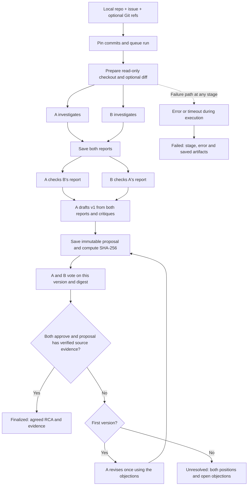

# Pyxis RCA harness

Pyxis investigates a reported bug in an existing local Git repository. Give it the repository path and the observed behavior. Two AI reviewers inspect the same committed source, challenge each other's explanations, and vote on an RCA (root cause analysis). A finalized RCA includes the causal explanation, cited source lines, and any evidence gaps. If reviewers still disagree after one revision, the result preserves both positions.

The harness runs locally on Node.js and calls installed agent CLIs. Their configured model providers can receive the issue text, code excerpts, and investigation results. The default reviewers are Claude Code and Codex. GitHub Copilot can fill either role. See the [installation and provider setup guide](SETUP.md).

## Browse your run workspace

Start `rca serve` and open the [local dashboard](http://127.0.0.1:4317/). Browse recent investigations, follow each workflow stage, and read the accepted reports, peer critiques, proposals, ballots, and terminal result. Each run also has a downloadable Markdown report.

The default workspace is this harness repository’s ignored `runs/` folder, even when the investigated repository is elsewhere. If a local `runs/START-HERE.md` exists, it indexes imported evidence. These ignored files are not included in Git clones. See [the run record guide](docs/RUN-RECORDS.md) for the file layout, privacy boundaries, and `RCA_RUNS_DIR` override.

## Run your first investigation

After setup, start the service in one terminal and leave it running.

```powershell
rca serve
```

Open a second terminal **in the repository containing the bug**. Describe a concrete input, the observed result, and the expected behavior. For example, in a project with a session-expiry bug:

```powershell
$run = rca run --repo . --issue "isExpired(61, 60000) returns false. A session expiring at 60 seconds should be expired at 61 seconds." | ConvertFrom-Json
$url = "http://127.0.0.1:4317"
Start-Process "$url/#$($run.runId)"
```

Once the service resolves the Git refs and queues the run, the CLI returns its ID. The dashboard follows that ID through investigation, critique, and voting. The default input is the checked-out commit (`HEAD`), so commit changes you want the reviewers to inspect. Use `--base <known-good-ref>` to include a comparison and `--head <ref>` to investigate another revision. Both refs resolve to commit IDs at submission.

## How a run reaches a decision



A citation records a full commit ID, repository-relative path, inclusive line range, and excerpt. The runner checks the excerpt against the Git object. Reviewers judge whether that code explains the symptom. A vote naming the wrong proposal version or digest fails immediately. First-round agreement takes seven agent-stage calls when every answer passes validation. A revision and revote bring the total to ten, before any validation retries.

Wrong-target ballots are treated conservatively as provenance incidents, rather than asking a new attempt to retarget its vote. This is a policy choice: every accepted ballot would still need to pass the same immutable version/digest checks after a retry. Recognizable target mismatches are checked before full schema validation, so an extra field cannot change that terminal outcome. Known rejected answers are recorded even if cancellation has already arrived, but cancellation prevents any further attempt.

Each role gets at most three attempts for a stage. Invalid model JSON, schema errors, empty model answers, and source-citation errors receive validation feedback and a fresh CLI call with the same pinned inputs. A completed successful Claude result with no structured answer follows this recovery path; malformed envelopes and provider error results remain terminal. A retry sees a bounded, quoted preview of its own rejected answer; the independent investigators never see each other's first report. Rejected answers are never repaired or published as accepted output. The original stage deadline covers all attempts and both peers; a recoverable error does not cancel the peer. Wrong proposal targets, cancellation, authentication failures, unsupported CLIs, corrupt provider event streams, and storage failures stop the stage. Copilot's native exit-1 empty-answer diagnostic is retryable only when its complete JSON event stream confirms an empty final root answer and failed terminal result. Native stderr supplies text error diagnostics; reviewer and tool text cannot classify an execution failure. Structured session errors remain terminal.

## Read results from a script

| Request | Behavior |
| --- | --- |
| `POST /runs` | Send JSON with an absolute `repo` path and an `issue` string. Optional fields are `base` and `head`. Returns HTTP 202 with `runId` and `status`. |
| `GET /runs` | Lists up to 100 recent run records, newest first, the active `storageRoot`, and configured reviewers for new submissions. |
| `GET /runs/{id}` | Returns the current `stage` and `status`. Poll while the status is `queued` or `running`. |
| `GET /runs/{id}/report` | Downloads the readable Markdown report as `pyxis-<id>-report.md`. |
| `GET /runs/{id}/artifacts` | Returns published JSON documents keyed by relative filename, including partial results. |

Using the variables from the example above:

```powershell
do {
    $state = Invoke-RestMethod "$url/runs/$($run.runId)"
    if ($state.status -in @('queued', 'running')) { Start-Sleep -Seconds 2 }
} while ($state.status -in @('queued', 'running'))
$artifacts = Invoke-RestMethod "$url/runs/$($run.runId)/artifacts"
$artifacts.'result.json' | ConvertTo-Json -Depth 12
```

Each run has a durable folder under `runs/<run-id>/` in the harness installation. `REPORT.md` presents the accepted review history, and `events.jsonl` records lifecycle and provider-call metadata. Workflow prompts are not recorded.

`run.json` holds the input, resolved commits, agent bindings, and status. `reports/`, `critiques/`, `proposals/`, and `votes/` preserve the accepted review history. `attempts/<stage>/<role>-<attempt>.json` records safe rejection categories, validation feedback, and whether another attempt was planned on every platform.

On POSIX, `diagnostics/` retains rejected model responses in owner-only files (mode 0600), excluded from the artifacts API. On Windows, raw rejected responses are not saved: POSIX modes do not restrict inherited Windows ACLs, and no opt-in bypass is provided.

Both safe rejection records and accepted outputs survive restart. Active work is marked interrupted on restart, rather than replaying a partially completed stage. `result.json` holds the terminal outcome. The runner cleans up the temporary checkout after recording that outcome.

These records contain the providers’ accepted structured outputs, not their hidden internal reasoning. Legacy private prompts and rejected diagnostics stay out of the public artifacts API and generated reports. Routine run storage does not capture native CLI stderr or private provider session dumps. Keep future validation logs, screenshots, and detailed execution evidence under the ignored `runs/` folder as well; [the run record guide](docs/RUN-RECORDS.md) explains the layout and sharing boundaries.

## Code map for contributors and AI agents

Start with the [agent onboarding notes](AGENTS.md), then follow a request through the code in this order.

| Component | Responsibility |
| --- | --- |
| [CLI](src/cli.ts) and [HTTP API](src/api/server.ts) | Resolve CLI paths, submit requests, serve the dashboard, and expose status and artifacts. |
| [Service](src/service.ts) | Validate and pin requests, bind reviewers, and run one queued investigation at a time. On restart, resume queued work and record interrupted active runs as failed. |
| [Git workspace](src/workspace.ts) | Prepare the pinned checkout, supply comparison evidence, verify citations, and clean up. |
| [Workflow](src/workflow/rca.ts) and [prompts](src/workflow/prompts.ts) | Control peer visibility, stage order, deadlines, the single revision, and finalization. |
| [Adapter registry](src/adapters/index.ts) and [process launcher](src/adapters/process.ts) | Translate stage requests into provider CLI calls and handle process output and cancellation. |
| [Types](src/types.ts), [JSON schemas](schemas/), and [store](src/store.ts) | Define the agent and run records, validate output shapes, and publish artifacts to disk. |

When changing a stage, check its prompt, output schema, and [workflow tests](tests/workflow.test.ts) together. Preserve the independent first reports, exact-version ballots, source verification, and partial results on failure. Run `npm run check` and `npm test` from the harness root for local verification. The [setup guide](SETUP.md) describes the separate live-provider tests.
